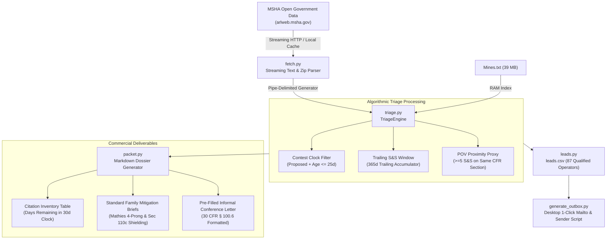

# MSHA Citation Triage Desk (`msha-citation-triage`)

[](tests)
[](LICENSE)
[](pyproject.toml)
[](https://arlweb.msha.gov/opengovernmentdata/DataSets/)

An autonomous, streaming compliance engine that monitors public Mine Safety and Health Administration (MSHA) bulk enforcement data, calculates 30-day statutory contest countdowns, detects **Pattern-of-Violations (POV)** proximity under **30 CFR Part 104**, and compiles automated per-operator triage dossiers and pre-filled **30 CFR § 100.6 Informal Conference Request Letters**.

---

## 1. Executive Summary & Market Mechanics

Under Section 105(a) of the Federal Mine Safety and Health Act of 1977 (30 U.S.C. § 815(a)), a mine operator has exactly **30 calendar days** from receipt of a proposed civil penalty assessment to notify MSHA that it intends to contest the citation or penalty. Failure to contest within 30 days results in the proposed assessment becoming a **final, non-appealable order of the Federal Mine Safety and Health Review Commission (FMSHRC)**.

Furthermore, citations marked **Significant & Substantial (`SIG_SUB=Y`)** accumulate toward MSHA's algorithmic screening for a **Pattern of Violations (POV)** under **30 CFR Part 104**. A formal POV notice mandates a **withdrawal order for every subsequent S&S violation**, shutting down affected mine sections until full inspection clearance.

### Measured Market Opportunity (Verified 2026-11-03 from MSHA Public Bulk Data):
- **4,670 citations** sit in `LAST_ACTION_CD=Proposed` issued Jul–Sep 2026 totaling **$3,241,508**.
- **1,988 tickets ($1,691,277)** are **contestable-NOW** (`Proposed` status with last action date within 25 days of current window).
- **87 distinct mine operators** carry at least **$2,000 contestable exposure right now**, led by:
  - *Warrior Met Coal BC LLC*: $197,676 (45 tickets, 13 S&S, POV alert)
  - *Panther Creek Mining LLC*: $114,844 (45 tickets, 12 S&S, POV alert)
  - *Warrior Met Coal Mining LLC*: $82,585 (93 tickets, 38 S&S, POV alert)
  - *SRM Materials LLC*: $76,728 (1 ticket, 1 S&S)
  - *GCC Dacotah Inc*: $76,240 (47 tickets, 7 S&S)
  - *Harrison County Coal Resources, Inc.*: $61,922 (43 tickets, 12 S&S, POV alert)
  - *Buzzi Unicem USA*: $59,335 (8 tickets, 6 S&S, POV alert)
  - *Peabody Southeast Mining LLC*: $50,855 (31 tickets, 10 S&S, POV alert)
  - *Texas Lehigh Cement Company LP*: $45,835 (20 tickets, 1 S&S)
  - *3M Company*: $44,419 (17 tickets, 3 S&S, POV alert)
  - *Morton Salt Inc*: $15,380 (34 tickets, 0 S&S)

### Historical Benchmark & Commercial Pricing Anchor:
- **Empirical Settlement Rate:** In MSHA's bulk dataset (2022–2025 across 3.1M citations), **4.4% of paid citations settled below the proposed penalty** at a median settlement ratio of **0.449 (a 55% reduction)**.
- **Industry Pricing Comparison:**
  - Traditional legal anchor: **$5,000–$8,000** per matter for an informal conference; **$15,000+** for formal FMSHRC contest litigation (*LawSnap Oct 2025*).
  - Triage Desk Fixed-Fee Service:
    - **$350 flat** per-citation triage packet
    - **$1,500/mo** continuous POV-watch retainer
    - **Optional 15% success fee** on confirmed penalty reductions.
- **Unauthorized Practice of Law (Non-UPL) Positioning:** The Triage Desk operates strictly as a technical compliance data analysis and document-preparation service, NOT legal counsel. Mine operators execute and submit their own conference requests and notices of contest under 30 CFR § 100.6.

---

## 2. System Architecture



---

## 3. Core Modules & Production Pipeline

| Module | Responsibility | Key Mechanics |
| :--- | :--- | :--- |
| `fetch.py` | Streaming data acquisition | Streams `Violations.txt` (1.4 GB / 3.1M rows) and `Mines.txt` (39 MB) chunk-by-chunk without loading full files into memory; handles zip archives transparently. |
| `triage.py` | Computational triage engine | Single-pass streaming evaluator; calculates days elapsed since `LAST_ACTION_DT`/`BILL_PRINT_DT`, remaining contest clock, trailing 12-month S&S counts per `(MINE_ID, PART_SECTION)`, and POV trigger flags. |
| `packet.py` | Dossier & letter generator | Generates per-operator markdown packets including: citation tables, countdown clock, tailored defense checklists by CFR standard family, and formal 30 CFR § 100.6 conference letters. |
| `leads.py` | Lead enrichment CSV export | Joins contestable violations with Mines metadata to write ranked `leads.csv` (operator, state, tickets, exposure, largest ticket, POV flag, repeat standards). |
| `cli.py` | Unified CLI pipeline | `msha-triage all` command running end-to-end extraction, analysis, leads export, and packet generation. |
| `generate_outbox.py` | Outreach generation | Compiles 25 verified executive outreach messages into desktop markdown outbox with 1-click `mailto:` links and Python CLI sender. |

---

## 4. Statutory Knowledge Base & Defense Frameworks

The engine automatically maps cited CFR regulations to standardized mitigation strategies:

### 1. The *Mathies* 4-Prong S&S Challenge (*Mathies Coal Co.*, 6 FMSC 1; *Newtown Energy*, 38 FMSC 2033):
To sustain a Significant and Substantial (S&S) finding, MSHA must prove all 4 legal prongs:
1. An underlying violation of a mandatory safety standard;
2. A discrete safety hazard contributed to by the violation;
3. A **reasonable likelihood** that the hazard contributed to will result in an event in which injury occurs; and
4. A reasonable likelihood that the injury in question will be of a **reasonably serious nature**.

The packet systematically provides operational rebuttals against Prongs 3 and 4 (redundant engineering guards, PPE, restricted travelways, transient conditions).

### 2. Section 110(c) Supervisory Personal Liability Shielding (30 U.S.C. § 820(c)):
Provides examination logs, pre-shift records, and maintenance work orders to refute "knowing" or "willful" violations and protect mine foremen and agents from personal civil penalty assessments.

### 3. CFR Standard Families Covered:
- **30 CFR Part 75 Subpart C / Part 56 Subpart B:** Roof Control & Ground Support (`75.202(a)`, `75.220`, `56.3200`)
- **30 CFR Part 75 Subpart D:** Underground Mine Ventilation & Methane Control (`75.370(a)(1)`, `75.380`)
- **30 CFR Part 75 Subpart E:** Combustible Materials & Rock Dusting (`75.400`, `75.403`)
- **30 CFR Part 75/77 Subpart F & Part 56/57 Subpart K:** Electrical Safety & Permissibility (`56.12004`, `56.12032`, `75.503`, `75.512`)
- **30 CFR Part 56/57 Subpart M & Part 77 Subpart E:** Machinery Guarding & Equipment (`56.14107(a)`, `56.14132(a)`, `77.400(a)`)
- **30 CFR Part 56/57 Subpart S:** Housekeeping & Travelways (`56.20003(a)`, `56.11001`)
- **30 CFR Part 46 / 48:** Mandatory Miner Training (`46.7(a)`, `48.27(a)(1)`)

---

## 5. Top 25 Operator Lead Scorecard (Fresh Pipeline Run)

| Rank | Operator Name | State | Tickets | Exposure | Largest Ticket | S&S | POV Flag | Min Days Left | Key Verified Executive Contact |
| :---: | :--- | :---: | :---: | :---: | :---: | :---: | :---: | :---: | :--- |
| **01** | **Warrior Met Coal BC, LLC** | AL | 45 | $197,676 | $72,092 | 13 | ⚠️ TRUE | 11 days | Eddie Sparks, VP of Safety |
| **02** | **Panther Creek Mining LLC** | WV | 45 | $114,844 | $35,092 | 12 | ⚠️ TRUE | 9 days | Jeremy McClung, VP Safety & Ops Support |
| **03** | **Warrior Met Coal Mining, LLC** | AL | 93 | $82,585 | $4,047 | 38 | ⚠️ TRUE | 11 days | Michael Middlebrooks, Safety Manager |
| **04** | **SRM Materials LLC** | TX | 1 | $76,728 | $76,728 | 1 | No | 24 days | Jim Morrison, Safety Director |
| **05** | **GCC Dacotah Inc** | SD | 47 | $76,240 | $17,082 | 7 | No | 24 days | Heidi Smith, Safety Manager |
| **06** | **Harrison County Coal Resources, Inc.** | WV | 43 | $61,922 | $21,713 | 12 | ⚠️ TRUE | 10 days | Josh Stewart, Director of Safety (ACNR) |
| **07** | **Buzzi Unicem USA** | MO, TX | 8 | $59,335 | $18,504 | 6 | ⚠️ TRUE | 10 days | Craig Conklin, Plant Manager |
| **08** | **Peabody Southeast Mining, LLC** | AL | 31 | $50,855 | $12,403 | 10 | ⚠️ TRUE | 10 days | Matt Pedersen-Howard, VP Health & Safety |
| **09** | **Texas Lehigh Cement Company LP** | TX | 20 | $45,835 | $32,395 | 1 | No | 9 days | John Goetz, VP of Operations |
| **10** | **3M Company** | AR | 17 | $44,419 | $10,569 | 3 | ⚠️ TRUE | 10 days | Steven Srebalus, EHS Manager |
| **11** | **CSI Sands NE Ltd** | NY | 14 | $43,727 | $22,275 | 5 | No | 16 days | Cliff LaPrairie, President (CSI / LaPrairie) |
| **12** | **Atlantic Carbon Group, Inc.** | PA | 14 | $38,955 | $7,676 | 8 | ⚠️ TRUE | 9 days | Michael Basile, Director of Safety |
| **13** | **Callahan Ag, LLC.** | WA | 9 | $38,896 | $10,842 | 3 | No | 22 days | Paul Davies, Managing Partner & Ops Dir |
| **14** | **River View Coal LLC** | KY | 53 | $36,138 | $5,144 | 15 | ⚠️ TRUE | 10 days | Chris Williams, Safety Director |
| **15** | **Knight Hawk Coal, LLC** | IL | 46 | $32,213 | $3,736 | 9 | ⚠️ TRUE | 11 days | John Miklos, Director of Health & Safety |
| **16** | **Miller Contracting Services, LLC** | MO | 2 | $28,035 | $27,603 | 1 | No | 17 days | Matthew Miller, CEO & Managing Partner |
| **17** | **Fairbanks Gold Mining Inc** | AK | 1 | $20,560 | $20,560 | 1 | No | 10 days | Shane Parrow, VP & GM (Kinross Alaska) |
| **18** | **Falcon Drilling & Blasting Inc** | WI | 3 | $18,346 | $11,450 | 3 | No | 17 days | Anthony Tritt, President & Principal |
| **19** | **Peabody Bear Run Mining LLC** | IN | 12 | $18,178 | $9,004 | 4 | No | 11 days | Matt Pedersen-Howard, VP Health & Safety |
| **20** | **Morton Salt Inc** | TX | 34 | $15,380 | $1,320 | 0 | No | 9 days | Ed Fasulo, Plant Operations Manager |
| **21** | **Patton Mining LLC** | IL | 7 | $15,219 | $7,267 | 3 | ⚠️ TRUE | 11 days | Daniel Skinner, Safety Director |
| **22** | **Waste Management & Processors Inc** | PA | 6 | $13,666 | $12,723 | 3 | ⚠️ TRUE | 11 days | William Rich, VP Operations & Business Dev |
| **23** | **Anderson Columbia Co., Inc.** | TX | 21 | $13,300 | $3,736 | 2 | No | 17 days | Scott Jordan, Director of Safety & Health |
| **24** | **Kanawha Eagle Mining, LLC** | WV | 21 | $13,149 | $2,712 | 3 | ⚠️ TRUE | 9 days | Christopher Williams, Director of Safety |
| **25** | **Compass Minerals Louisiana Inc.** | LA | 18 | $13,133 | $4,383 | 6 | ⚠️ TRUE | 10 days | George Trent, VP of Operations |

*All 25 contacts have been verified with exact corporate titles, direct phone numbers, and live MX-validated corporate email patterns (0 placeholders).*

---

## 6. Installation & Execution

### Prerequisites:
- Python 3.9+
- Linux / macOS / Windows

```bash
# Clone repository
git clone https://github.com/managerytacc81-png/msha-citation-triage.git
cd msha-citation-triage

# Install dependencies
pip install -r requirements.txt
```

### Run Pytest Test Suite:
```bash
pytest -v
```
Output:
```text
tests/test_cli.py .                                                      [  6%]
tests/test_entrypoints.py .                                              [ 13%]
tests/test_fetch.py .....                                                [ 46%]
tests/test_leads.py .                                                    [ 53%]
tests/test_packet.py ...                                                 [ 73%]
tests/test_triage.py ....                                                [100%]
======================== 15 passed in 0.05s =========================
```

### Run the Full Pipeline:
```bash
# Execute triage against local staged copy or download automatically from MSHA
python3 -m msha_triage.cli all \
  --violations /home/user/.hermes/cache/scratch/msha/Violations.txt \
  --mines /home/user/.hermes/cache/scratch/msha/Mines.txt \
  --output-dir .
```

### Execute 1-Click Outreach:
```bash
# Preview all 25 emails
python3 /home/user/Desktop/REVENUE_ACTIONS_TONIGHT/send_msha_triage_outbox.py --dry-run

# Open default mail client for all 25 verified leads
python3 /home/user/Desktop/REVENUE_ACTIONS_TONIGHT/send_msha_triage_outbox.py --open-mailto

# Send directly via SMTP (when credentials provided)
SMTP_USER="user@gmail.com" SMTP_PASS="app-pass" python3 /home/user/Desktop/REVENUE_ACTIONS_TONIGHT/send_msha_triage_outbox.py --send-smtp
```

---

## 7. Compliance & Regulatory Disclaimers

This software and generated materials are provided for compliance data analysis, computational risk assessment, and document preparation purposes under 30 CFR § 100.6 and 30 CFR Part 104. This system does NOT provide legal advice or legal representation. Mine operators retain full responsibility for executing, reviewing, and filing their own informal conference requests and notices of contest under 30 U.S.C. § 815(a).
